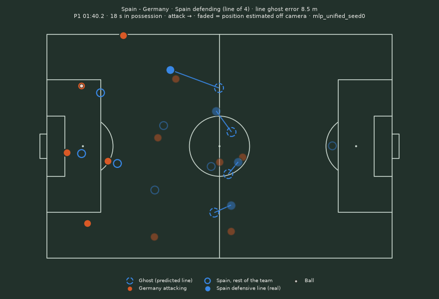

# Horse

**Learning defensive positioning from real football matches.**

Horse is a football *ghosting* tool. Given the positions of the attacking team and
the ball, a model trained on real tracking data predicts where defenders would
usually be. Comparing these "ghost" defenders with the real ones shows where a
defence left its usual shape, and by how much. The current goal is to analyse how
**national teams defend at the 2022 World Cup**: one model learns "how teams defend
at the World Cup", and the places where a team (e.g. Germany) systematically differs
from its ghosts describe its style.



*Spain - Germany, Spain defending: the real defensive line (filled) and its ghosts
(dashed). Spain presses high while Germany builds up from the back; the model,
trained on another game, expects the line much deeper. Faded markers are positions
PFF estimated off camera. Pipeline check on 3 games only: no conclusions yet.*

## Monorepo

| Folder | Stack | Status |
|---|---|---|
| [`ml/`](ml/) | Python 3.12, uv, kloppy, pandas, mplsoccer, scikit-learn, PyTorch, FastAPI, pytest | Phase 4 in progress |
| [`backend/`](backend/) | Spring Boot (Java 25), PostgreSQL + Flyway, Kafka, Redis, Spring AI | Skeleton only |
| [`frontend/`](frontend/) | Angular | Not started |

## Roadmap

1. **Data & visualization** (Metrica sample game): load, explore, plot. *(done)*
2. **Preprocessing** (Metrica): metres, attacking direction, velocities, possession,
   fixed role order, time-block split. *(done)*
3. **Ghosting models** (Metrica): metric in metres, baselines, MLP, ghosts. *(done;
   Metrica stays in the repo as a worked example)*
4. **World Cup 2022** (PFF FC data): defensive-line ghosting for all nations, common
   roles, variable line of 3/4/5, split by game. *(current phase: pipeline built and
   checked on Germany's 3 games; next: all 64 games, then per-team style analysis)*
5. **Model serving**: FastAPI inference service.
6. **Backend**: Spring Boot with matches stored in PostgreSQL (Flyway migrations),
   Kafka for frame streaming, Redis caching, Spring AI for natural-language
   explanations of defensive errors.
7. **Frontend**: Angular app with an interactive pitch showing real vs ghost defenders.

## Quick start (ml)

```bash
cd ml
uv sync                                         # install Python 3.12 + dependencies

# World Cup 2022 (PFF FC) - raw files must be placed in ml/data/raw/pff/ (see ml/README.md)
uv run python -m horse_ml.worldcup.build        # -> ml/data/processed/pff/
uv run python -m horse_ml.ghosting.train --dataset worldcup
uv run python -m horse_ml.ghosting.evaluate --dataset worldcup
uv run python -m horse_ml.viz.wc_ghosts         # -> ml/outputs/wc_ghost_*.png / .gif

# Metrica sample game (phases 1-3)
uv run python -m horse_ml.data.download
uv run python -m horse_ml.preprocessing.build
uv run python -m horse_ml.ghosting.train
uv run python -m horse_ml.ghosting.evaluate
uv run python -m horse_ml.viz.ghosts

uv run pytest
```

See [`ml/README.md`](ml/README.md) for details.

## Results so far

- **Metrica** (one game, 11 defenders, test): mean shape 14.8 m, ridge on the ball
  9.7 m, kNN 7.1 m, MLP 6.2 m. Details in
  [`ml/README.md`](ml/README.md#ghosting-models-phase-3).
- **World Cup**: pipeline checked end to end on Germany's 3 group games (one game
  per split). The numbers only prove that everything runs; see
  [`ml/README.md`](ml/README.md#world-cup-2022-phase-4).

## Data and licenses

**World Cup 2022 - Gradient Sports / PFF FC.** Broadcast tracking and event data of
all 64 games of the 2022 FIFA World Cup, produced by PFF FC (now Gradient Sports).
We use a copy from an **unofficial Google Drive mirror**; **no terms of use are
known** for it. Therefore:
- raw data is **never** committed (it lives in the git-ignored `ml/data/raw/pff/`);
- the repo only contains small derived reference tables (`ml/reference/`: game list,
  split assignment, manual corrections of the defensive line) and plots;
- a future public demo will show only results and plots, never raw data.

**Metrica Sports sample data**: <https://github.com/metrica-sports/sample-data>,
anonymized tracking and event data. The repository has **no explicit license** (no
LICENSE file; GitHub reports `license: null`). Its README, under "Legal stuff",
states only:

> Please be responsible with the use of this data.
> If you use it for anything public, please acknowledge the source.

Raw Metrica data is downloaded by a script into `ml/data/` (git-ignored). The images
in `docs/images/` are plots derived from these datasets. Without a formal license,
terms for redistribution or commercial use are not granted explicitly for either
source.
