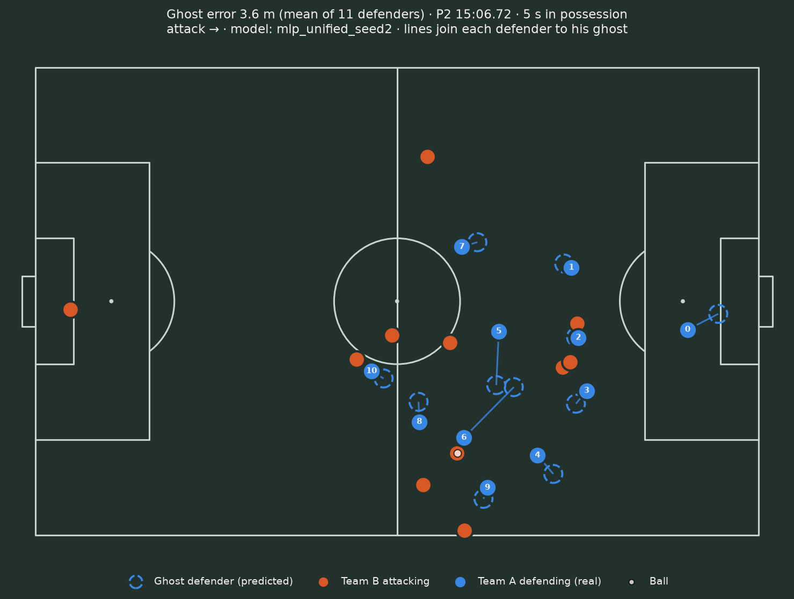
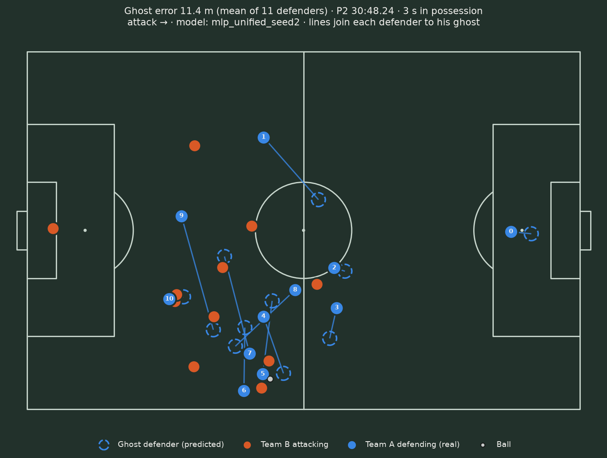

# horse-ml

Python side of Horse: data loading, exploration, visualization, preprocessing and
the ghosting models.

## Setup

Requires [uv](https://docs.astral.sh/uv/). It installs Python 3.12 and every
dependency into `ml/.venv`:

```bash
cd ml
uv sync
```

## Commands

All commands run from `ml/`.

| Command | What it does |
|---|---|
| `uv run python -m horse_ml.data.download` | Downloads Metrica Sample Game 3 into `data/raw/metrica/` (~55 MB, skips existing files) |
| `uv run python -m horse_ml.explore` | Prints a summary: frame rate, coordinates, frames, players, ball, events |
| `uv run python -m horse_ml.viz.frame` | Plots one frame (default: the first goal) to `outputs/frame.png` |
| `uv run python -m horse_ml.viz.animate` | Renders 10 s of play (default: build-up to the first goal) to `outputs/animation.gif` |
| `uv run python -m horse_ml.preprocessing.build` | Builds the training samples into `data/processed/` (~75 s per game) and prints a summary |
| `uv run python -m horse_ml.viz.sample` | Plots one processed sample with velocity arrows to `outputs/sample.png` |
| `uv run python -m horse_ml.ghosting.train` | Trains all models, tunes them on **validation**, saves them to `models/` (~3 min) |
| `uv run python -m horse_ml.ghosting.evaluate` | **One-time** test evaluation: results table to `models/results.md` |
| `uv run python -m horse_ml.viz.ghosts` | Ghost plots from validation: `outputs/ghost_low.png`, `ghost_high.png`, `ghost_high.gif` |
| `uv run pytest` | Runs the tests (real-data tests are skipped if the data is not downloaded) |

`frame` and `animate` accept `--period` and `--time` / `--start` to pick another moment;
`viz.sample` accepts `--sample-id`; `preprocessing.build` accepts `--games`;
`ghosting.train` accepts `--seeds`.

## Layout

```
src/horse_ml/
├── paths.py            # data/ and outputs/ locations (override with HORSE_DATA_DIR)
├── data/
│   ├── download.py     # fetches raw files from GitHub
│   ├── loading.py      # load_tracking() / load_events() via kloppy
│   ├── games.py        # registry of games the pipeline processes
│   └── selection.py    # find events, slice frames by time
├── explore.py          # dataset summary
├── preprocessing/
│   ├── coordinates.py  # Metrica [0,1] -> metres, half-time and possession flips
│   ├── frames.py       # one wide table per game: positions in metres
│   ├── kinematics.py   # Savitzky-Golay velocities, impossible speeds -> NaN
│   ├── possession.py   # team in possession + ball in play from events
│   ├── roles.py        # fixed slot order per team (roles, fallback: average position)
│   ├── samples.py      # defensive samples at 5 Hz
│   ├── split.py        # train/val/test by alternating 3-minute blocks
│   └── build.py        # runs everything, writes Parquet + metadata.json
├── ghosting/
│   ├── dataset.py      # samples -> feature / target arrays
│   ├── metrics.py      # distance error: total, per slot, per team, settled
│   ├── baselines.py    # mean shape, ridge on the ball, kNN on the situation
│   ├── mlp.py          # PyTorch MLP, loss in metres, early stopping
│   ├── train.py        # trains + tunes on validation, saves models/
│   └── evaluate.py     # one-time test evaluation, results table
└── viz/
    ├── pitch.py        # pitch, colors, draw one frame
    ├── frame.py        # single-frame PNG
    ├── animate.py      # GIF animation
    ├── sample.py       # one processed sample with velocity arrows
    └── ghosts.py       # real vs ghost defenders (PNG + GIF)
```

## Data notes (Metrica Sample Game 3)

- **Frame rate**: 25 Hz, 143,761 frames (~96 minutes over 2 periods).
- **Coordinates**: Metrica's own system, x and y normalized to `[0, 1]`, origin
  top-left, y pointing down. Pitch is 105 × 68 m. Positions slightly outside
  `[0, 1]` happen when the ball or a player crosses the lines.
- **Players**: 17 (home) and 18 (away) in the squads, always 11 vs 11 on the pitch.
- **Ball**: x/y known in ~68% of frames (missing when out of play or not
  tracked); no height (z) and no ball state in the tracking data.
- **Events**: 3,594 events (passes, carries, recoveries, shots...). Timestamps are
  relative to the start of each period, the same as tracking frames, so they align.
- Games 1 and 2 in the same repo use a CSV event format that kloppy does not read,
  which is why we use Game 3.
- **Roles**: the metadata gives every player a nominal role and template position.
  Team A plays 4-2-3-1, Team B 4-4-2. Substitutes have roles too, but one (Team A
  no. 13) duplicates a teammate's role, so it is placed by average position.
- **Team B forwards**: the metadata calls them "Right Forward" and "Left Forward",
  but on the pitch they are a **first and a second striker** (both central, one
  higher, one dropping deeper). Slots 9 and 10 of Team B keep the metadata labels.

## Processed dataset (phase 2)

`data/processed/samples.parquet`, one row per sample, plus `metadata.json`
(frame rate, coordinate system, split blocks, slot roles per team, column meaning).

- **Coordinates**: metres, origin at the centre spot, y up, **team in possession
  attacking towards +x**. Pitch is [-52.5, 52.5] × [-34, 34].
- **Input**: `ball_{x,y,vx,vy}` and `att_{k}_{x,y,vx,vy}` for the 11 attackers.
- **Target**: `def_{k}_{x,y}` for the 11 defenders (`def_{k}_{vx,vy}` kept for analysis).
- **Slots** `k = 0..10`: fixed role order per team (GK, back line right to left,
  midfield, forwards). Slot k is a different role for each formation: see the
  `{att,def}_{k}_role` and `*_formation` columns.
- **Context**: `game_id, period, timestamp_s, split, attacking_team, defending_team,
  seconds_since_possession_change` (transitions are kept, not filtered).
- **Sampling**: 5 Hz, only frames with the ball in play, known possession and all
  22 players + ball with valid position and velocity.
- **Velocities**: Savitzky-Golay, 7-frame window (0.28 s), polynomial order 2.
  Player speed p99 is 6.3 m/s and p99.9 is 8.0 m/s, nearly identical with 5- or
  11-frame windows; values above 12 m/s (players) or 40 m/s (ball) become NaN.
- **Split**: each period is cut into ~3-minute blocks; whole blocks go to train / val
  / test (~70/15/15). Among 5,000 random block assignments (fixed seed) the one with
  the most balanced sample counts and defending teams is kept (only counts are used,
  never positions). 10 s are discarded at every boundary between different splits.
  Game 3: 13,402 train (21 blocks), 2,666 val (5), 2,702 test (5); Team A defends in
  48.8% / 48.9% / 46.2% of them (48.4% overall).

## Ghosting models (phase 3)

**Metric**: for each sample, the Euclidean distance in metres between predicted and
real defender, averaged over the 11 defenders. Reported in total, per slot, per
defending team, and on *settled* situations (more than 3 s since the last
possession change). All choices (hyperparameters, MLP configuration, best model)
are made on **validation**; the test set is evaluated once, at the end.

**Models**, each fitted per defending team unless stated:

- **(a) Mean shape**: average position of each slot. Ignores the ball.
- **(b) Ridge on the ball**: linear regression with x, y, x², y², x·y of the ball;
  regularization α = 100 chosen on validation.
- **(c) kNN on the situation**: mean defenders of the k = 200 most similar train
  situations (ball + 11 attackers, positions standardized; velocities did not help).
- **(d) MLP**: 48 inputs (ball + attackers, positions and velocities) → 2 hidden
  layers of 256 → 22 outputs. Inputs standardized; targets centred with one shared
  scale for x and y; the loss is the distance in metres (= the metric). Adam,
  dropout 0.5, weight decay 0.01, early stopping on validation. Trained with 3
  seeds. (d1) one network per team; (d2) one network with the defending team as a
  one-hot input.

**Results** (metres, lower is better):

| Model | Train | Val | Val settled | Test | Test settled | Test, Team A defending | Test, Team B defending | Δ test vs best |
|---|---|---|---|---|---|---|---|---|
| (a) Mean shape | 16.59 | 16.16 | 15.19 | 14.76 | 13.38 | 14.07 | 15.34 | +8.53 |
| (b) Ridge on ball position | 10.10 | 10.24 | 9.73 | 9.68 | 9.10 | 9.95 | 9.44 | +3.45 |
| (c) kNN on situation | 5.99 | 7.12 | 6.88 | 7.08 | 6.73 | 6.83 | 7.30 | +0.85 |
| (d1) MLP, one per team | 5.16 ± 0.05 | 6.41 ± 0.03 | 6.16 ± 0.03 | 6.24 ± 0.04 | 5.91 ± 0.03 | 6.04 ± 0.05 | 6.42 ± 0.02 | +0.01 ≈ |
| (d2) MLP, unified + team input | 5.53 ± 0.07 | 6.32 ± 0.03 | 6.05 ± 0.04 | 6.23 ± 0.02 | 5.91 ± 0.02 | 6.06 ± 0.02 | 6.37 ± 0.05 | best (on val) |

Samples: train 13,402, val 2,666, test 2,702. MLP rows: mean ± std over 3 seeds.
≈ = difference smaller than 2 × the seed-to-seed std on test (0.04 m), i.e. not
meaningful.

What the table says:

- Every step adds information and lowers the error: knowing the ball (b) removes
  a third of the error of a fixed shape (a); knowing the attackers (c, d) another third.
- **The two MLP variants are equivalent** on test (Δ 0.01 m, inside the seed noise).
  The unified one overfits less (train-to-test gap 0.7 m against 1.1 m).
- **Overfitting is the main issue**: one game gives ~13,000 samples, but they are
  strongly correlated (5 per second of the same play). A lightly regularized MLP
  reached its best validation error after 1-2 epochs; heavy dropout and weight
  decay were needed. The kNN train error is optimistic (each train sample is its
  own neighbour).
- **Per slot** (best model, test): centre backs and goalkeepers are the easiest
  (2-4.5 m), central midfielders the hardest (7-9 m). The worst slot is Team B's
  second striker (13.7 m), who drops deep and roams.
- Settled situations are ~0.3 m easier than transitions.

**Ghosts** (best model on validation, moments from the validation set):

| Low error (3.6 m) | High error (11.4 m) |
|---|---|
|  |  |

The high-error moment is the worst frame of the highest-error 10-second window
among settled situations with the ball always in play, after rejecting windows with
tracking problems (position jumps > 0.6 m between frames, teammates on the same
spot, players far off the pitch). The clip is
[`docs/images/ghost_high.gif`](../docs/images/ghost_high.gif): Team A presses high
and narrow, and the midfielders are on average 10-14 m away from where the model
expects them.

### Honest limits

- **The model learns where this team usually defends, not the "ideal" position.**
  A ghost is the defence's own habit in a similar situation. A large error means
  "different from usual", which can be a mistake, a deliberate tactical choice
  (pressing, as in the clip above) or a situation the model has rarely seen.
- **One game, two teams.** The "usual" behaviour comes from 90 minutes of one match;
  it does not generalize to other teams, opponents or game states. More games are
  the most important next step.
- **Each defender is predicted independently of the others**: ghosts can overlap or
  leave gaps no real defence would leave.
- **Single frames**: the model does not see the previous seconds of play; sequence
  models are a natural next step.
